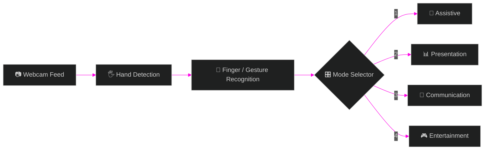

<div align="center">


<a href="https://github.com/thansee-r/ECHO">
  
</a>

<br/><br/>


<br/>

### ⚡ [Quick Start](#-quick-start) &nbsp;•&nbsp; 🎯 [Modes](#-the-4-modes) &nbsp;•&nbsp; 🧠 [How It Works](#-how-it-works) &nbsp;•&nbsp; 🗺️ [Roadmap](#️-roadmap) &nbsp;•&nbsp; 👥 [Team](#-the-team)

</div>

<br/>

---

## 🎬 Demo

<div align="center">

<!-- 👉 Replace with your main demo GIF (recommended width: 800px) -->
<!--  -->

<sub>📹 Add a demo GIF here: it is the first thing visitors look at.</sub>

</div>

---

## 💡 Why ECHO?

<table>
<tr>
<td align="center" width="25%">
<h3>🖐️</h3>
<b>Touch-Free</b><br/>
<sub>Control everything with your hand</sub>
</td>
<td align="center" width="25%">
<h3>📷</h3>
<b>Just a Webcam</b><br/>
<sub>No gloves, sensors or extra gear</sub>
</td>
<td align="center" width="25%">
<h3>⚡</h3>
<b>Real-Time</b><br/>
<sub>Instant recognition, live feedback</sub>
</td>
<td align="center" width="25%">
<h3>🎛️</h3>
<b>4 Modes</b><br/>
<sub>One app, many use cases</sub>
</td>
</tr>
</table>

---

## 🎯 The 4 Modes

> Hold up fingers in front of the webcam after launch. ECHO switches modes instantly.

<div align="center">

| ☝️ **1 Finger** | ✌️ **2 Fingers** | 🤟 **3 Fingers** | 🖖 **4 Fingers** |
|:---:|:---:|:---:|:---:|
| 🦾 **Assistive** | 📊 **Presentation** | 💬 **Communication** | 🎮 **Entertainment** |
| <sub>description</sub> | <sub>description</sub> | <sub>description</sub> | <sub>description</sub> |
| <!--  --> | <!--  --> | <!--  --> | <!--  --> |

</div>

<details>
<summary><b>🦾 Assistive Mode: gestures</b></summary>
<br/>

| Gesture | Action |
|---|---|
| <!-- gesture --> | <!-- action --> |

</details>

<details>
<summary><b>📊 Presentation Mode: gestures</b></summary>
<br/>

| Gesture | Action |
|---|---|
| <!-- gesture --> | <!-- action --> |

</details>

<details>
<summary><b>💬 Communication Mode: gestures</b></summary>
<br/>

| Gesture | Action |
|---|---|
| <!-- gesture --> | <!-- action --> |

</details>

<details>
<summary><b>🎮 Entertainment Mode: gestures</b></summary>
<br/>

| Gesture | Action |
|---|---|
| <!-- gesture --> | <!-- action --> |

</details>

---

## 🧠 How It Works



---

## 🚀 Quick Start

> [!IMPORTANT]
> ECHO was built and tested on **Python 3.10.x**. Use this version to avoid dependency issues.
> 📥 Recommended: [**Python 3.10.11** (Windows installer, 64-bit)](https://www.python.org/downloads/release/python-31011/)

```bash
# 1️⃣  Clone the repo
git clone https://github.com/thansee-r/ECHO.git
cd ECHO

# 2️⃣  Create a virtual environment
python -m venv .venv

# 3️⃣  Activate it
.venv\Scripts\activate            # Windows
# source .venv/bin/activate       # macOS / Linux

# 4️⃣  Install dependencies
pip install -r requirements.txt

# 5️⃣  Launch ECHO 🚀
python main.py
```

<details>
<summary><b>💻 Using VS Code?</b></summary>
<br/>

```bash
cd ECHO
code .
```

Open the integrated terminal with `` Ctrl + ` `` and continue from step 2.

</details>

<details>
<summary><b>🛠️ Troubleshooting</b></summary>
<br/>

| Problem | Fix |
|---|---|
| Dependency errors on install | Confirm `python --version` shows **3.10.x** |
| `activate` is blocked in PowerShell | Run `Set-ExecutionPolicy -Scope Process RemoteSigned`, then activate again |
| Camera does not open | Close other apps using the webcam and check camera permissions |
| Gestures are not detected | Improve lighting and keep one hand fully in frame |

</details>

---

## ⚠️ Limitations

> [!WARNING]
> - ✋ **Single-hand** gesture recognition only
> - 💡 Performance may vary in **poor or uneven lighting**

---

## 🗺️ Roadmap

- [x] Real-time hand tracking via webcam
- [x] Four interaction modes
- [ ] Multi-hand gesture support
- [ ] Better low-light performance
- [ ] More gestures per mode

<sub>Edit this list to match your real plans.</sub>

---

## 🛠️ Built With


<!--  -->
<!--  -->

---

## 🤝 Contributing

Contributions, issues and feature requests are welcome!

1. 🍴 Fork the repo
2. 🌿 Create a branch: `git checkout -b feature/amazing-gesture`
3. 💾 Commit: `git commit -m "Add amazing gesture"`
4. 📤 Push: `git push origin feature/amazing-gesture`
5. 🔀 Open a Pull Request

---

## 👥 The Team

<div align="center">

<table>
  <tr>
    <td align="center" width="200">
      <a href="https://github.com/Rishi18360">
        <br/><br/>
        <b>Rishi Raj A</b><br/>
        <sub>@Rishi18360</sub>
      </a>
    </td>
    <td align="center" width="200">
      <a href="https://github.com/ihsansak">
        <br/><br/>
        <b>Ihsan Sakeer</b><br/>
        <sub>@ihsansak</sub>
      </a>
    </td>
    <td align="center" width="200">
      <a href="https://github.com/thansee-r">
        <br/><br/>
        <b>Thanseer Ahmed M S</b><br/>
        <sub>@thansee-r</sub>
      </a>
    </td>
    <td align="center" width="200">
      <a href="https://github.com/AshwinSabu05">
        <br/><br/>
        <b>Ashwin Sabu</b><br/>
        <sub>@AshwinSabu05</sub>
      </a>
    </td>
  </tr>
</table>

</div>

---

<div align="center">

### ⭐ If ECHO impressed you, drop a star!


</div>
