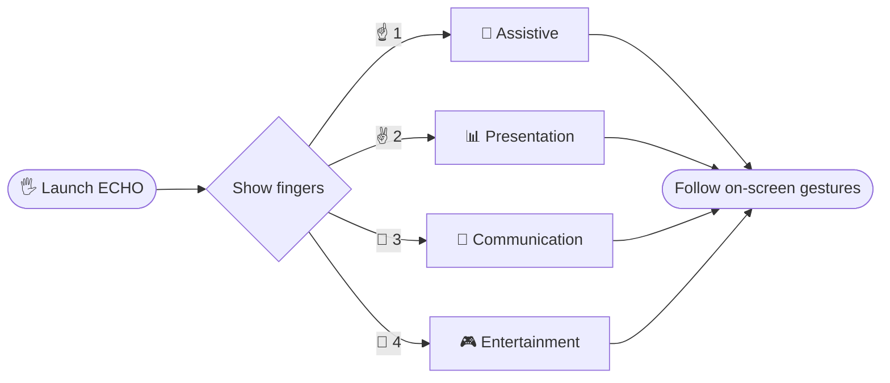

<div align="center">


<a href="https://github.com/thansee-r/ECHO">
  
</a>

<br/>


<br/>

**[✨ Features](#-features) · [🎯 Modes](#-modes) · [🚀 Quick Start](#-quick-start) · [⚠️ Limitations](#️-limitations) · [👥 Team](#-meet-the-team)**

</div>

---

## 🎬 See It in Action

<div align="center">

<!-- Replace with your own demo GIF -->
<!--  -->

| 🦾 Assistive | 📊 Presentation | 💬 Communication | 🎮 Entertainment |
|:---:|:---:|:---:|:---:|
| <!--  --> | <!--  --> | <!--  --> | <!--  --> |

</div>

---

## ✨ Features

<table>
<tr>
<td width="50%">

### 🖐️ Touch-Free Control
Navigate everything with hand gestures alone.

</td>
<td width="50%">

### 🎛️ 4 Smart Modes
Switch instantly by holding up fingers.

</td>
</tr>
<tr>
<td width="50%">

### 📷 Webcam Only
No gloves, sensors or special hardware.

</td>
<td width="50%">

### ⚡ Real-Time
Live recognition with on-screen guidance.

</td>
</tr>
</table>

---

## 🎯 Modes

Hold up fingers in front of the webcam right after launch to choose a mode.



| Fingers | Mode | What it does |
|:---:|---|---|
| ☝️ | **Assistive** | <!-- one-line description --> |
| ✌️ | **Presentation** | <!-- one-line description --> |
| 🤟 | **Communication** | <!-- one-line description --> |
| 🖖 | **Entertainment** | <!-- one-line description --> |

---

## 🚀 Quick Start

> [!IMPORTANT]
> ECHO was developed and tested on **Python 3.10.x**. Stick to this version to avoid dependency issues.
> Recommended: [**Python 3.10.11** (Windows installer, 64-bit)](https://www.python.org/downloads/release/python-31011/)

```bash
# 1️⃣ Clone
git clone https://github.com/thansee-r/ECHO.git
cd ECHO

# 2️⃣ Create a virtual environment
python -m venv .venv

# 3️⃣ Activate it
.venv\Scripts\activate          # Windows
# source .venv/bin/activate     # macOS / Linux

# 4️⃣ Install dependencies
pip install -r requirements.txt

# 5️⃣ Launch 🚀
python main.py
```

<details>
<summary><b>💻 Prefer VS Code?</b></summary>

<br/>

```bash
cd ECHO
code .
```

Then open the integrated terminal (`` Ctrl + ` ``) and continue from step 2 above.

</details>

---

## ⚠️ Limitations

> [!WARNING]
> - ✋ Supports **single-hand** gesture recognition only
> - 💡 Performance may drop in **poor or uneven lighting**

---

## 🛠️ Built With


<!-- Add your libraries, for example: -->
<!--  -->
<!--  -->

---

## 👥 Meet the Team

<div align="center">

<table>
  <tr>
    <td align="center" width="180">
      <a href="https://github.com/Rishi18360">
        <br/><br/>
        <b>Rishi Raj A</b>
      </a><br/>
      <sub>@Rishi18360</sub>
    </td>
    <td align="center" width="180">
      <a href="https://github.com/ihsansak">
        <br/><br/>
        <b>Ihsan Sakeer</b>
      </a><br/>
      <sub>@ihsansak</sub>
    </td>
    <td align="center" width="180">
      <a href="https://github.com/thansee-r">
        <br/><br/>
        <b>Thanseer Ahmed M S</b>
      </a><br/>
      <sub>@thansee-r</sub>
    </td>
    <td align="center" width="180">
      <a href="https://github.com/AshwinSabu05">
        <br/><br/>
        <b>Ashwin Sabu</b>
      </a><br/>
      <sub>@AshwinSabu05</sub>
    </td>
  </tr>
</table>

</div>

---

<div align="center">

### ⭐ Like ECHO? Give it a star!


</div>
