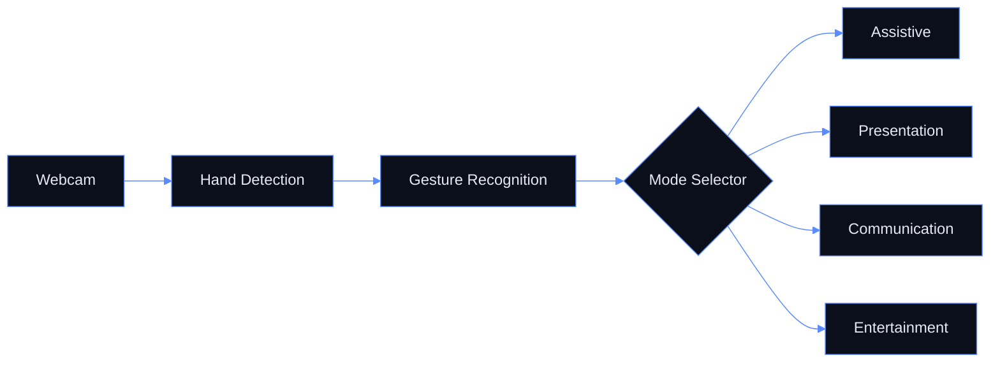

<div align="center">


<br/>

**Control your computer with a single hand.**<br/>
Real-time gesture recognition through any webcam. No hardware. No contact.

<br/>


<br/><br/>

[**Overview**](#overview) &nbsp;·&nbsp; [**Modes**](#modes) &nbsp;·&nbsp; [**Installation**](#installation) &nbsp;·&nbsp; [**Architecture**](#architecture) &nbsp;·&nbsp; [**Team**](#team)

</div>

<br/>

<div align="center">

<!-- Replace with your hero demo GIF or video thumbnail (recommended: 1200 x 675) -->
<!--  -->

</div>

<br/>

## Overview

ECHO turns your webcam into an input device. Show your hand, pick a mode with your fingers, and control the experience with gestures. There is no extra hardware to buy and nothing to wear.

<br/>

<table>
  <tr>
    <td width="33%" valign="top">
      <h4>Touchless</h4>
      <sub>Operate everything with hand gestures alone. No mouse, no keyboard.</sub>
    </td>
    <td width="33%" valign="top">
      <h4>Instant</h4>
      <sub>Real-time recognition with live on-screen guidance for every gesture.</sub>
    </td>
    <td width="33%" valign="top">
      <h4>Hardware-free</h4>
      <sub>Works with the webcam you already have. Nothing to install but Python.</sub>
    </td>
  </tr>
</table>

<br/>

## Modes

Hold up fingers in front of the camera at launch to choose a mode.

<br/>

<table>
  <tr>
    <th align="center" width="25%">01</th>
    <th align="center" width="25%">02</th>
    <th align="center" width="25%">03</th>
    <th align="center" width="25%">04</th>
  </tr>
  <tr>
    <td align="center"><b>Assistive</b><br/><sub>1 finger</sub></td>
    <td align="center"><b>Presentation</b><br/><sub>2 fingers</sub></td>
    <td align="center"><b>Communication</b><br/><sub>3 fingers</sub></td>
    <td align="center"><b>Entertainment</b><br/><sub>4 fingers</sub></td>
  </tr>
  <tr>
    <td align="center" valign="top"><sub><!-- one-line description --></sub></td>
    <td align="center" valign="top"><sub><!-- one-line description --></sub></td>
    <td align="center" valign="top"><sub><!-- one-line description --></sub></td>
    <td align="center" valign="top"><sub><!-- one-line description --></sub></td>
  </tr>
</table>

<br/>

Once a mode is active, follow the on-screen instructions to perform its gestures.

<details>
<summary><b>Gesture reference</b></summary>
<br/>

| Mode | Gesture | Action |
|---|---|---|
| Assistive | <!-- gesture --> | <!-- action --> |
| Presentation | <!-- gesture --> | <!-- action --> |
| Communication | <!-- gesture --> | <!-- action --> |
| Entertainment | <!-- gesture --> | <!-- action --> |

</details>

<br/>

## Installation

> [!IMPORTANT]
> ECHO was developed and tested on **Python 3.10.x**. Use this version to avoid dependency conflicts.
> Recommended: [Python 3.10.11, Windows installer (64-bit)](https://www.python.org/downloads/release/python-31011/)

<br/>

**1. Clone the repository**

```bash
git clone https://github.com/thansee-r/ECHO.git
cd ECHO
```

**2. Create and activate a virtual environment**

```bash
python -m venv .venv
.venv\Scripts\activate          # Windows
# source .venv/bin/activate     # macOS / Linux
```

**3. Install dependencies**

```bash
pip install -r requirements.txt
```

**4. Run**

```bash
python main.py
```

<details>
<summary><b>Troubleshooting</b></summary>
<br/>

| Issue | Resolution |
|---|---|
| Dependency errors | Confirm `python --version` reports 3.10.x |
| Activation blocked in PowerShell | Run `Set-ExecutionPolicy -Scope Process RemoteSigned`, then retry |
| Camera fails to open | Close other apps using the webcam and check camera permissions |
| Gestures not detected | Improve lighting and keep one hand fully in frame |

</details>

<br/>

## Architecture



<br/>

## Limitations

- Single-hand gesture recognition only
- Performance may vary under poor or uneven lighting

<br/>

## Roadmap

- [x] Real-time hand tracking
- [x] Four interaction modes
- [ ] Multi-hand support
- [ ] Improved low-light performance
- [ ] Expanded gesture library

<br/>

## Contributing

Pull requests are welcome. For major changes, open an issue first to discuss what you would like to change.

```bash
git checkout -b feature/your-feature
git commit -m "Add your feature"
git push origin feature/your-feature
```

<br/>

## Team

<div align="center">

<table>
  <tr>
    <td align="center" width="200">
      <a href="https://github.com/Rishi18360">
        <br/><br/>
        <b>Rishi Raj A</b><br/>
        <sub>@Rishi18360</sub>
      </a>
    </td>
    <td align="center" width="200">
      <a href="https://github.com/ihsansak">
        <br/><br/>
        <b>Ihsan Sakeer</b><br/>
        <sub>@ihsansak</sub>
      </a>
    </td>
    <td align="center" width="200">
      <a href="https://github.com/thansee-r">
        <br/><br/>
        <b>Thanseer Ahmed M S</b><br/>
        <sub>@thansee-r</sub>
      </a>
    </td>
    <td align="center" width="200">
      <a href="https://github.com/AshwinSabu05">
        <br/><br/>
        <b>Ashwin Sabu</b><br/>
        <sub>@AshwinSabu05</sub>
      </a>
    </td>
  </tr>
</table>

</div>

<br/>

<div align="center">


<sub>If ECHO is useful to you, consider starring the repository.</sub>

</div>
